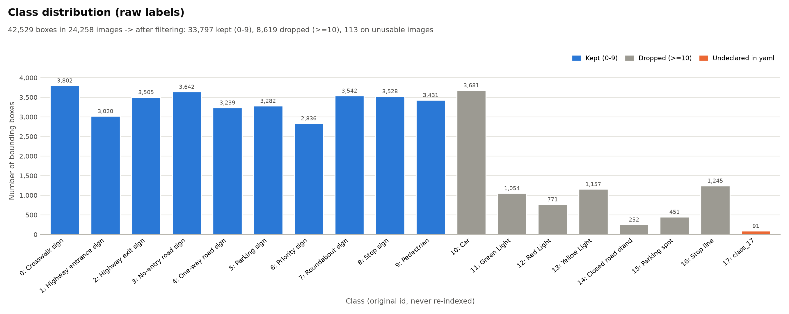
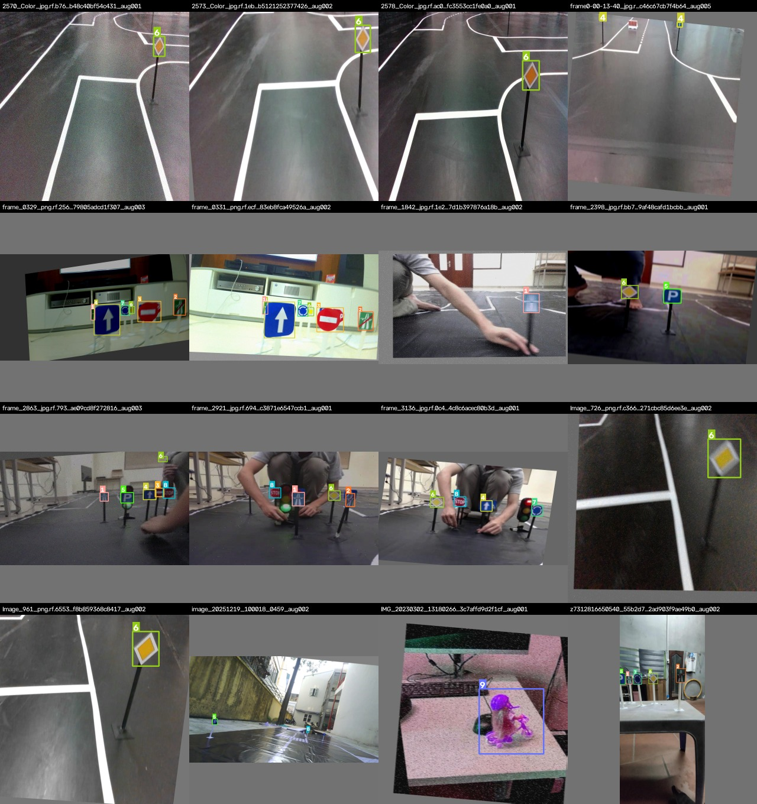
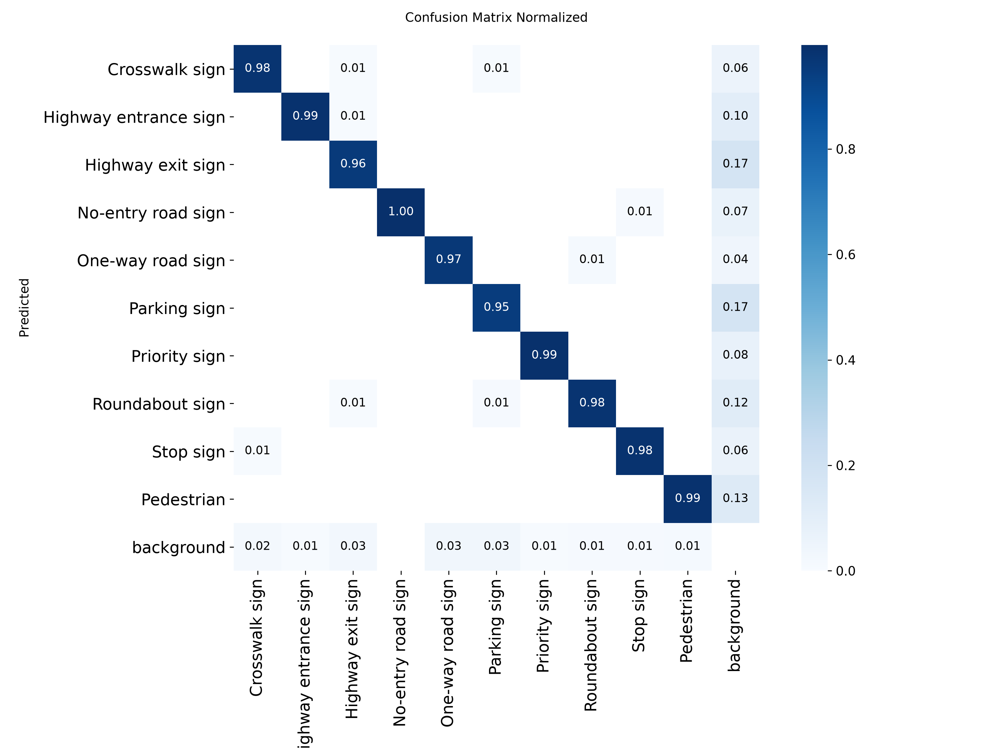

# BKAuto YOLO26 Vision — Nhận diện biển báo & người đi bộ cho xe tự hành RC trên Hailo-8

Dự án xây dựng chuỗi **End-to-End Edge AI** cho module nhận thức thị giác của xe tự hành RC trên sa bàn: từ bộ dữ liệu thô, qua huấn luyện mô hình trên GPU server, tới lượng tử hóa INT8 và biên dịch lên NPU **Hailo-8 (26 TOPS)** gắn trên **Raspberry Pi 5**.

| Hạng mục | Lựa chọn |
|---|---|
| Server huấn luyện | NVIDIA GeForce RTX 5070 Ti |
| Thiết bị biên | Raspberry Pi 5 + Hailo-8 NPU (Cấu hình 1 của đề bài) |
| Mô hình | YOLO26m (Ultralytics) — kiến trúc NMS-free |
| Lớp mục tiêu | 10 lớp: 9 loại biển báo + người đi bộ |
| Chuỗi công cụ | Ultralytics → ONNX → Hailo Dataflow Compiler → HEF → HailoRT |

**Tiến độ**

| Giai đoạn | Nội dung | Trạng thái |
|---|---|---|
| 1 | Kỹ nghệ dữ liệu (EDA, làm sạch, lọc lớp, chia tập, cân bằng) | Hoàn thành |
| 2 | Huấn luyện & đánh giá Baseline | Hoàn thành |
| 3 | Xuất ONNX, tập hiệu chuẩn PTQ, biên dịch Hailo DFC | Đã có ONNX và tập hiệu chuẩn; **chưa chạy biên dịch HEF** |
| 4 | Triển khai & đo kiểm trên RPi5 + Hailo-8 | Chưa thực hiện |

Mọi số liệu trong tài liệu này lấy từ các lần chạy thực tế; các mục chưa có số đo được ghi rõ là chưa thực hiện.

---

## Mục lục
1. [Tổng quan pipeline](#1-tổng-quan-pipeline)
2. [Giai đoạn 1 — Kỹ nghệ dữ liệu](#2-giai-đoạn-1--kỹ-nghệ-dữ-liệu)
3. [Giai đoạn 2 — Huấn luyện Baseline](#3-giai-đoạn-2--huấn-luyện-baseline)
4. [Giai đoạn 3 — Tối ưu hóa & biên dịch NPU](#4-giai-đoạn-3--tối-ưu-hóa--biên-dịch-npu)
5. [Giai đoạn 4 — Triển khai trên thiết bị biên (kế hoạch)](#5-giai-đoạn-4--triển-khai-trên-thiết-bị-biên-kế-hoạch)
6. [Tái lập kết quả](#6-tái-lập-kết-quả)
7. [Cấu trúc thư mục](#7-cấu-trúc-thư-mục)
8. [Hạn chế & hướng phát triển](#8-hạn-chế--hướng-phát-triển)

---

## 1. Tổng quan pipeline

```
 Dữ liệu thô (Roboflow, 24.258 ảnh, 18 lớp)
        │  EDA → làm sạch → lọc giữ lớp 0–9 → background negatives
        │  → chia tập theo chuỗi (chống rò rỉ) → cân bằng lớp bằng augmentation
        ▼
 Train / Val / Test (80 / 10 / 10)
        │  Huấn luyện YOLO26m trên RTX 5070 Ti (AdamW + Cosine LR, Early Stopping)
        ▼
 Baseline FP32  ──►  Đánh giá trên Test (mAP, P/R/F1, Confusion Matrix, FLOPs)
        │  Xuất ONNX tĩnh (NMS-free) → tách phần NPU / phần CPU
        ▼
 ONNX thuần NPU + 300 ảnh hiệu chuẩn
        │  Hailo DFC: Parse → PTQ INT8 → Compile
        ▼
 HEF  ──►  RPi5 + Hailo-8: NPU tính backbone/neck/head, CPU decode box
```

Nguyên tắc xuyên suốt: **mỗi bước đều có cơ chế kiểm chứng** (kiểm tra rò rỉ dữ liệu, so khớp số học giữa các định dạng mô hình, đối chiếu với manifest), và **mọi lựa chọn ngẫu nhiên đều cố định seed = 42** để kết quả tái lập được.

---

## 2. Giai đoạn 1 — Kỹ nghệ dữ liệu

### 2.1 Khám phá dữ liệu (EDA)

Công cụ EDA tự nhận diện định dạng nhãn (YOLO `.txt`, COCO `.json`, Pascal VOC `.xml`). Bộ dữ liệu gốc là **export YOLO của Roboflow**. Các phát hiện chính:

| Chỉ số | Giá trị |
|---|---|
| Tổng số ảnh | 24.258 (≈1,2 GB) |
| Ảnh có file nhãn / không có file nhãn | 16.348 / 7.910 |
| File nhãn rỗng | 6 |
| Ảnh 0 byte (hỏng) | 76 |
| Số độ phân giải khác nhau | 28 — chủ yếu 640×384 (59,9%), 640×640 (31,7%), 1920×1080 (5,8%) |
| Tổng bounding box | 42.529 |
| Mật độ box | trung bình 2,6 box / ảnh có nhãn, tối đa 13 |



Ba phát hiện ảnh hưởng trực tiếp đến thiết kế các bước sau:

1. **Có một lớp ẩn — class 17 (91 box)** — xuất hiện trong nhãn nhưng không khai báo trong `data.yaml`. Quy tắc lọc vì vậy phải là "giữ 0–9", không chỉ "xóa 10–16".
2. **Bộ dữ liệu bị nhân bản bởi augmentation của Roboflow.** 24.258 file chỉ đến từ khoảng **10.500 frame gốc**; mỗi frame có từ 1 đến 23 bản sao (hậu tố `.rf.<hash>`). Đặc biệt **837 frame gốc nằm rải rác ở nhiều split** của Roboflow — tức là bản chia Train/Valid/Test có sẵn đã **rò rỉ dữ liệu** và không thể dùng.
3. **Các lớp mục tiêu tương đối cân bằng**: lớp nhiều nhất / ít nhất chỉ chênh 1,34 lần.

Biểu đồ EDA (lưu tại [`reports/eda/`](reports/eda/)):

| Biểu đồ | Mục đích |
|---|---|
| [`class_distribution.png`](reports/eda/class_distribution.png) | Số box mỗi lớp; tô màu riêng lớp giữ lại / loại bỏ / lớp không khai báo |
| [`resolution_distribution.png`](reports/eda/resolution_distribution.png) | Phân bố độ phân giải khung hình |
| [`boxes_per_image.png`](reports/eda/boxes_per_image.png) | Mật độ bounding box trên mỗi ảnh |
| [`bbox_size_distribution.png`](reports/eda/bbox_size_distribution.png) | Tỉ lệ vật thể nhỏ / vừa / lớn (theo chuẩn COCO) cho từng lớp |
| [`copies_per_stem.png`](reports/eda/copies_per_stem.png) | Số bản sao Roboflow trên mỗi frame gốc — bằng chứng cho rủi ro rò rỉ |

### 2.2 Lọc lớp mục tiêu

Theo thống nhất với giảng viên, dự án **giữ nguyên 10 lớp gốc với ID 0–9** (9 loại biển báo và `9: Pedestrian`) **thay vì gộp và đánh lại chỉ mục thành 2 lớp**. Lý do: giữ được thông tin loại biển báo (xe cần phân biệt biển Stop với biển Cấm đi ngược chiều), đồng thời ID gốc không bị thay đổi nên nhãn luôn đối chiếu được với dữ liệu thô.

| ID | Lớp | ID | Lớp |
|---|---|---|---|
| 0 | Crosswalk sign | 5 | Parking sign |
| 1 | Highway entrance sign | 6 | Priority sign |
| 2 | Highway exit sign | 7 | Roundabout sign |
| 3 | No-entry road sign | 8 | Stop sign |
| 4 | One-way road sign | 9 | Pedestrian |

Toàn bộ box của các lớp khác bị loại: Car, đèn giao thông xanh/đỏ/vàng, Closed road stand, Parking spot, Stop line và lớp ẩn 17 — tổng cộng **8.616 box**. Sau lọc còn **33.797 box** thuộc 10 lớp mục tiêu. Khi báo cáo theo 2 nhóm như đề bài, nhóm `traffic_sign` là trung bình của các lớp 0–8 và nhóm `pedestrian` là lớp 9.

### 2.3 Làm sạch dữ liệu

| Biện pháp | Kết quả |
|---|---|
| Loại ảnh 0 byte | 76 ảnh |
| Giải mã toàn bộ ảnh để phát hiện ảnh hỏng | 0 ảnh hỏng |
| Phát hiện & sửa JPEG bị cắt cụt | 0 trường hợp |
| Box có tọa độ vượt biên nhẹ (sai số làm tròn ≤ 1%) | 357 box được cắt (clip) về trong khung ảnh |
| Box vượt biên nhiều, diện tích ≤ 0, cạnh < 2 px | Loại bỏ (không có trường hợp nào) |
| Box có tỉ lệ khung hình bất thường (> 20) | 3 box bị loại |
| Dòng nhãn trùng lặp | Loại bỏ |
| Ảnh trùng nội dung từng byte (khác tên) | 25 nhóm — được ghép chung nhóm khi chia tập |

### 2.4 Background negatives (ảnh nền không chứa đối tượng)

Ảnh nền giúp mô hình học cách "không báo động giả" — rất quan trọng với xe RC vì phần lớn thời gian camera nhìn đường trống, và một biển Stop báo nhầm có thể khiến xe phanh gấp. Nhưng giữ quá nhiều ảnh nền sẽ làm mô hình "nhút nhát", giảm Recall.

- **Pool ảnh nền: 12.396 ảnh**, gồm ảnh không có file nhãn, ảnh có file nhãn rỗng, và ảnh chỉ chứa các lớp đã bị loại (xe, đèn giao thông…). Nhóm cuối là *hard negatives* rất giá trị: dạy mô hình rằng "đèn đỏ không phải biển Stop".
- **Loại 764 ảnh "đáng ngờ"**: ảnh không có nhãn nhưng một bản sao khác của cùng frame gốc lại có biển báo — thực chất là ảnh chưa được gán nhãn. Dùng chúng làm ảnh nền sẽ dạy mô hình bỏ qua biển báo thật.
- **Giữ 10% pool trong từng split** (chọn sau khi chia tập, ưu tiên đa dạng frame). Nhờ lấy mẫu sau khi chia, việc đổi tỉ lệ ảnh nền khi thử nghiệm không làm thay đổi tập Test.
- Kết quả: **1.137 ảnh nền**, chiếm **9,0%** tập dữ liệu cuối — nằm trong khoảng 5–10% đề bài khuyến nghị.

### 2.5 Chia tập chống rò rỉ dữ liệu (Sequence-based Split)

Dữ liệu sa bàn được cắt từ video: hai frame liên tiếp gần như giống hệt nhau. Nếu xáo trộn ngẫu nhiên từng ảnh rồi chia, frame ở Test sẽ có "anh em sinh đôi" ở Train → mAP trên Test bị **ảo** (cao hơn thực tế). Bộ dữ liệu này còn tệ hơn vì Roboflow đã sao chép mỗi frame nhiều lần. Dự án **không dùng bản chia sẵn của Roboflow** mà chia lại theo chiến lược sau:

1. **Gom nhóm theo frame gốc** — mọi bản sao Roboflow của cùng một frame và mọi ảnh trùng byte luôn đi cùng nhau.
2. **Sắp xếp tự nhiên theo tên file** để các frame liên tiếp của một video nằm cạnh nhau.
3. **Cắt thành khối 25 frame liên tiếp** (421 khối). Khối nhỏ quá thì nhiều ranh giới, dễ rò rỉ; khối lớn quá thì Val/Test kém đa dạng. Kích thước 25 được chọn sau khi khảo sát 5–60.
4. **Gán nguyên khối vào Train/Val/Test theo tỉ lệ 80/10/10 có phân tầng**: thuật toán *iterative stratification* bảo đảm số box của **từng lớp** đều chia đúng 80/10/10, tránh trường hợp Test thiếu một loại biển báo.
5. **Khoảng đệm (purge gap)**: tại 126 ranh giới giữa khối Train và khối Val/Test, bỏ 2 frame phía Train để hai frame sát nhau không bao giờ nằm ở hai tập khác nhau.
6. **Kiểm chứng tự động**: 0 frame gốc và 0 ảnh trùng byte xuất hiện ở hơn một tập.

| Tập | Số ảnh | Tỉ lệ | Ảnh nền | Số box |
|---|---|---|---|---|
| Train | 10.071 | 79,9% | 909 | 26.284 |
| Val | 1.244 | 9,9% | 114 | 3.298 |
| Test | 1.287 | 10,2% | 114 | 3.278 |

Với **từng lớp**, tỉ lệ box giữa ba tập lệch tối đa **0,17 điểm phần trăm** so với 80/10/10.

### 2.6 Cân bằng lớp & tăng cường dữ liệu (Augmentation)

Mất cân bằng giữa các lớp ở mức nhẹ (tỉ lệ 1,34). Giải pháp: **sinh thêm ảnh cho các lớp thiểu số trong tập Train** cho tới khi mọi lớp bằng lớp đông nhất, ưu tiên chọn ảnh nguồn mà lớp thiểu số chiếm ưu thế để không làm phình thêm lớp đông. Mỗi frame gốc được dùng tối đa 5 lần để tránh lặp lại một cảnh.

Các phép biến đổi được chọn **bám theo điều kiện vật lý của xe RC**:

| Phép biến đổi | Mô phỏng |
|---|---|
| Color Jitter / HSV shift | Ánh sáng sa bàn thay đổi. **Hue chỉ dịch rất nhỏ** vì màu đỏ/xanh là đặc trưng phân biệt giữa các loại biển |
| Brightness / Contrast / Gamma | Phơi sáng camera khác nhau |
| Motion Blur | Camera rung lắc khi xe chạy nhanh |
| Random Affine (dịch, co giãn, xoay nhẹ, nghiêng) | Thay đổi khoảng cách và góc nhìn tới biển báo |
| Nhiễu cảm biến, nén JPEG | Chất lượng camera giá rẻ |
| **Không lật ảnh** (ngang hay dọc) | Lật làm sai nghĩa biển một chiều, đổi chiều vòng xuyến, đảo lối vào/ra cao tốc — biển "soi gương" không tồn tại ngoài thực tế |

Kết quả: **1.599 ảnh được sinh thêm**, mọi lớp đạt đúng **2.946 box** trong Train, tỉ lệ mất cân bằng giảm từ 1,34 xuống **1,00**. Augmentation **chỉ áp dụng cho Train** — Val/Test giữ nguyên để phản ánh dữ liệu thật. Mosaic không làm offline mà để trình huấn luyện thực hiện trực tuyến.



---

## 3. Giai đoạn 2 — Huấn luyện Baseline

### 3.1 Lựa chọn kiến trúc: YOLO26m

- **NMS-free (end-to-end)**: head của YOLO26 gán mỗi vật thể đúng một dự đoán (one-to-one), nên không cần thuật toán Non-Maximum Suppression ở hậu xử lý. NMS là thuật toán tuần tự, kích thước động — không chạy được trên NPU và tốn CPU của Raspberry Pi.
- **Bỏ DFL** (Distribution Focal Loss): đồ thị gọn hơn, ít toán tử Softmax, dễ lượng tử hóa INT8 hơn.
- **Biến thể Medium** thay vì nano/small: tận dụng năng lực 26 TOPS của Hailo-8 để ưu tiên độ chính xác, đặc biệt với biển báo nhỏ ở xa.
- Khởi tạo từ trọng số COCO để hội tụ nhanh trên tập dữ liệu sa bàn.

### 3.2 Siêu tham số

| Nhóm | Thiết lập | Lý do |
|---|---|---|
| Đầu vào | 640×640, batch 16 | Bội số 32 cho NPU; batch vừa VRAM 16 GB của RTX 5070 Ti và chừa tài nguyên cho người dùng chung server |
| Optimizer | AdamW, lr0 = 0,001, weight decay 5e-4 | Thích nghi bước học theo từng tham số, ổn định khi fine-tune; lr nhỏ hơn mặc định của SGD |
| Lịch learning rate | Cosine Annealing (lr cuối = 1% lr0), warmup 3 epoch | Giảm lr mượt giúp các epoch cuối tinh chỉnh độ khớp box |
| Warmup bias lr | 0 | Với AdamW, lr của bias khi warmup không nên vượt 0,01 |
| Augmentation trực tuyến | Mosaic 1.0, HSV (0,015 / 0,7 / 0,4), translate 0,1, scale 0,5, **không lật** | Đa dạng bối cảnh, giữ nguyên nghĩa biển chỉ hướng |
| Độ chính xác | Mixed precision (AMP FP16) | Nhanh hơn, tiết kiệm VRAM |
| Tái lập | seed 42, chế độ deterministic | Kết quả lặp lại được giữa các lần chạy |

### 3.3 Cơ chế kiểm soát huấn luyện

- **Validate đúng nhánh sẽ triển khai.** Mặc định Ultralytics chấm điểm bằng nhánh one-to-many kèm NMS. Dự án ép validate bằng **nhánh one-to-one NMS-free** — chính nhánh sẽ chạy trên Hailo-8 — để mọi quyết định (chọn mô hình tốt nhất, dừng sớm) dựa trên đúng mô hình triển khai.
- **Early Stopping theo mAP@0.5:0.95 trên tập Val**, patience = 50 epoch, tối đa 200 epoch. Chỉ số mAP@0.5:0.95 khắt khe về độ khớp box nên phản ánh tốt khả năng định vị biển báo nhỏ.
- **Theo dõi bằng TensorBoard**: loss train/val, mAP, Precision, Recall và learning rate theo từng epoch.
- **Checkpoint kép**: lưu `best.pt` (FP16, gọn nhẹ) và `best_fp32.pt` — bản **FP32 thật** chụp tại thời điểm epoch tốt nhất, làm mốc gốc không qua làm tròn FP16 cho bước lượng tử hóa INT8.
- **Chặn cấu hình nguy hiểm**: huấn luyện dừng ngay nếu cấu hình có bật lật ảnh.

### 3.4 Quá trình hội tụ

Huấn luyện **dừng sớm ở epoch 99/200**; mô hình tốt nhất ở **epoch 49** với **mAP@0.5:0.95 = 0,804** và **mAP@0.5 = 0,972** trên tập Val.

| Epoch | mAP@0.5:0.95 (Val) | Box loss (Train) | Box loss (Val) |
|---|---|---|---|
| 1 | 0,713 | 0,973 | 1,036 |
| 10 | 0,764 | 0,827 | 0,923 |
| 30 | 0,795 | 0,695 | 0,818 |
| **49 (tốt nhất)** | **0,804** | 0,632 | 0,779 |
| 80 | 0,798 | 0,541 | 0,777 |
| 99 (dừng) | 0,798 | 0,499 | 0,774 |

Sau epoch 49, loss trên Train tiếp tục giảm mạnh trong khi loss Val đi ngang và mAP Val không tăng thêm — dấu hiệu mô hình bắt đầu học thuộc tập Train. Early Stopping đã cắt huấn luyện đúng lúc và giữ lại mô hình của epoch 49.

### 3.5 Đánh giá Baseline trên tập Test

Đánh giá mô hình FP32 trên **1.287 ảnh Test (3.278 vật thể)**, dùng nhánh NMS-free.

**Chỉ số toàn cục**

| Precision | Recall | F1 | mAP@0.5 | mAP@0.5:0.95 |
|---|---|---|---|---|
| 96,14% | 96,70% | 96,42% | **97,93%** | **80,89%** |

**Chỉ số từng lớp**

| Lớp | Số vật thể | P | R | F1 | mAP@0.5 | mAP@0.5:0.95 |
|---|---|---|---|---|---|---|
| 0 Crosswalk sign | 368 | 97,59 | 97,28 | 97,44 | 98,80 | 84,53 |
| 1 Highway entrance sign | 293 | 95,10 | 98,63 | 96,84 | 98,83 | 86,53 |
| 2 Highway exit sign | 336 | 95,52 | 93,75 | 94,63 | 98,06 | 77,81 |
| 3 No-entry road sign | 351 | 95,89 | 99,61 | 97,71 | 97,47 | 80,47 |
| 4 One-way road sign | 316 | 97,25 | 94,62 | 95,91 | 99,15 | 84,86 |
| 5 Parking sign | 317 | 91,97 | 94,64 | 93,29 | 92,55 | 79,53 |
| 6 Priority sign | 273 | 97,55 | 99,27 | 98,40 | 98,98 | 81,68 |
| 7 Roundabout sign | 341 | 97,28 | 94,50 | 95,87 | 98,07 | 80,44 |
| 8 Stop sign | 346 | 97,38 | 96,77 | 97,08 | 98,27 | 83,28 |
| 9 Pedestrian | 337 | 95,83 | 97,92 | 96,87 | 99,15 | 69,79 |

**Theo hai nhóm của đề bài** (trung bình các lớp trong nhóm)

| Nhóm | P | R | F1 | mAP@0.5 | mAP@0.5:0.95 |
|---|---|---|---|---|---|
| traffic_sign (lớp 0–8) | 96,17 | 96,56 | 96,35 | 97,80 | 82,13 |
| pedestrian (lớp 9) | 95,83 | 97,92 | 96,87 | 99,15 | 69,79 |

**Nhận xét**

- Mô hình **gần như không nhầm lẫn giữa các loại biển báo**: số cặp nhầm lớn nhất chỉ 4 trường hợp (One-way ↔ Roundabout).
- Sai số chủ yếu là **báo nhầm trên nền** (dự đoán có vật thể ở nơi không có), tập trung ở Highway exit, Parking sign (30 trường hợp mỗi lớp) và Pedestrian (22). Số vật thể bị bỏ sót thấp (50 trên 3.278).
- **Pedestrian** có mAP@0.5 rất cao (99,15%) nhưng mAP@0.5:0.95 thấp nhất (69,79%): mô hình tìm thấy hình nhân nhưng **khung bao chưa thật khít** — hình nhân có hình dạng không đều, khó xác định biên hơn biển báo phẳng.
- **Parking sign** là lớp yếu nhất theo mAP@0.5 (92,55%).

Ma trận nhầm lẫn được dựng ở **ngưỡng confidence 0,25** (gần ngưỡng triển khai thực tế), thay vì ngưỡng 0,001 dùng để tính mAP — ở ngưỡng 0,001 ma trận sẽ đầy báo nhầm vô nghĩa. Precision/Recall/F1 từng lớp được lấy tại ngưỡng confidence làm F1 trung bình cao nhất.



**Độ phức tạp tính toán** (mốc so sánh cho lượng tử hóa)

| Hạng mục | Đồ thị huấn luyện (2 nhánh head) | Đồ thị triển khai (fused, chỉ nhánh NMS-free) |
|---|---|---|
| Số tham số | 21,79 triệu | **20,36 triệu** |
| FLOPs @ 640×640 | 75,03 GFLOPs | **68,12 GFLOPs (34,06 GMACs)** |

| File trọng số | Kích thước |
|---|---|
| `best.pt` (FP16) | 42,02 MB |
| `best_fp32.pt` (FP32) | 83,77 MB |

Thời gian suy luận trên RTX 5070 Ti là 3,9 ms/ảnh — **chỉ để tham khảo**, không phải số đo trên thiết bị biên.

Kết quả chi tiết: [`reports/baseline_eval/yolo26m_baseline-2/`](reports/baseline_eval/yolo26m_baseline-2/) (JSON, CSV từng lớp, ma trận nhầm lẫn dạng ảnh và CSV, đường cong PR/F1).

---

## 4. Giai đoạn 3 — Tối ưu hóa & biên dịch NPU

### 4.1 Chuyển đổi sang ONNX và phân tách NPU / CPU

- Xuất ONNX với **đầu vào tĩnh 1×3×640×640** (Hailo DFC không chấp nhận trục động), **nhánh NMS-free**, opset 17, trọng số FP32.
- Rút gọn đồ thị bằng **onnxsim** (gấp hằng số, bỏ node thừa): 478 → 418 node; kiểm tra hợp lệ bằng `onnx.checker`.
- **Phân tích phần đuôi đồ thị.** YOLO26 không có NMS, nhưng sau head vẫn còn 35 node chọn ra 300 box tốt nhất, chứa các toán tử khó ánh xạ lên NPU: `TopK` ×2, `GatherElements` ×3, `Mod`, `ReduceMax`, `Expand`, `Cast`. Phía trước điểm cắt không còn toán tử nào loại này.
- **Quyết định phân tách**:
  - **NPU** chạy backbone, neck và head đến **6 lớp Conv cuối** — mỗi tỉ lệ (stride 8/16/32) có một Conv dự đoán box (4 kênh) và một Conv dự đoán lớp (10 kênh).
  - **CPU** của Raspberry Pi làm phần hậu xử lý nhẹ: sigmoid cho điểm lớp, tính tọa độ box từ anchor, chọn 300 box điểm cao nhất. **Không cần NMS.**
  - 6 điểm cắt này trùng với cấu hình YOLO26m chính thức của Hailo Model Zoo.
- Kết quả là hai file: ONNX đầy đủ (`yolo26m.onnx`, 77,9 MB) và ONNX thuần NPU (`yolo26m_npu.onnx`, 77,8 MB).

**Kiểm chứng số học** trên 16 ảnh Test (35 vật thể, ngưỡng confidence 0,25):

| So sánh | Lệch tọa độ box tối đa | Lệch điểm tối đa | Kết quả |
|---|---|---|---|
| PyTorch so với ONNX đầy đủ | 6,1 × 10⁻⁵ px | 2,1 × 10⁻⁶ | Đạt |
| ONNX đầy đủ so với (ONNX thuần NPU + hậu xử lý CPU) | 2,7 × 10⁻⁵ px | 6,0 × 10⁻⁸ | Đạt |

Phép so sánh thứ hai chứng minh **công thức hậu xử lý dự kiến chạy trên CPU của Raspberry Pi tái hiện chính xác** phần đuôi đồ thị đã bị cắt.

### 4.2 Tập hiệu chuẩn cho lượng tử hóa sau huấn luyện (PTQ INT8)

- **300 ảnh** chọn ngẫu nhiên (seed 42) từ tập Train, **bỏ các ảnh augmentation nhân tạo** để tập hiệu chuẩn phản ánh đúng phân phối frame camera thật.
- Tiền xử lý **giống hệt lúc suy luận**: letterbox giữ tỉ lệ khung hình về 640×640 với viền xám 114, chuyển BGR → RGB. Kết quả letterbox được đối chiếu **trùng khớp từng byte** với Ultralytics.
- Lưu ở dạng **uint8 [0, 255], bố cục NHWC** (300 × 640 × 640 × 3, 352 MB) theo khuyến nghị của Hailo:
  - phép chia 255 được gộp vào lớp đầu tiên chạy trên NPU (lớp normalization);
  - ảnh camera vốn là số nguyên 8-bit nên lượng tử hóa đầu vào không mất mát;
  - Raspberry Pi gửi thẳng frame uint8 qua PCIe — ít hơn 4 lần băng thông so với float32, trong khi PCIe của Pi 5 chỉ có 1 lane.
- Mean RGB của tập hiệu chuẩn: 118,5 / 114,9 / 112,2; std: 56,4 / 55,4 / 53,6. Tập hiệu chuẩn tái lập được — dựng lại trên máy khác cho ra đúng các giá trị này.

### 4.3 Biên dịch với Hailo Dataflow Compiler — *chưa thực hiện*

Quy trình đã chuẩn bị (yêu cầu Hailo DFC 3.x, phiên bản ≥ 3.33.1 — nhánh duy nhất hỗ trợ Hailo-8 và YOLO26):

1. **Parse**: nạp ONNX thuần NPU (hoặc ONNX đầy đủ kèm 6 điểm cắt) thành Hailo Archive.
2. **Model script**: chuẩn hóa đầu vào trên NPU; dùng đủ 300 ảnh hiệu chuẩn (DFC mặc định chỉ dùng 64); mức tối ưu 2 kèm fine-tune sau lượng tử hóa; **lượng tử 16-bit cho 6 đầu ra** để giảm sai số điểm và tọa độ khi decode trên CPU.
3. **PTQ INT8** với tập hiệu chuẩn.
4. **Compile** thành file `yolo26m.hef`.
5. **Phân tích ánh xạ toán tử**: tính tỉ lệ layer chạy trên NPU và **cảnh báo nếu có bất kỳ layer nào rơi về CPU**. Trên Hailo-8 không có cơ chế tự động đẩy toán tử không hỗ trợ về CPU — toán tử lạ làm biên dịch thất bại — nên việc tách sẵn phần đuôi ở bước 4.1 là bắt buộc. Báo cáo cũng ghi lại ánh xạ từng đầu ra của HEF về loại (box/lớp) và stride, phục vụ bước decode ở Giai đoạn 4.
6. **Hailo Profiler**: FPS, độ trễ, số context ước tính.

Kết quả sẽ được ghi vào `reports/npu_compilation_report.json`. **Tham chiếu từ Hailo** (chưa phải số đo của dự án): YOLO26m trên Hailo-8 được chia thành 4 context, đạt 48,7 FPS ở batch 1 khi đo qua PCIe Gen3 ×4. Raspberry Pi 5 chỉ có PCIe ×1 nên FPS thực tế dự kiến thấp hơn — số chính thức phải đo trên phần cứng thật.

---

## 5. Giai đoạn 4 — Triển khai trên thiết bị biên (kế hoạch)

Giai đoạn này chưa thực hiện. Định hướng dựa trên các quyết định đã chốt ở trên:

- **Tiền xử lý trên CPU**: letterbox về 640×640 (giống hệt tập hiệu chuẩn), chuyển RGB, gửi frame **uint8** sang NPU — không chuẩn hóa float trên CPU.
- **NPU** chạy HEF qua HailoRT, trả về 6 tensor đầu ra.
- **Hậu xử lý trên CPU**: sigmoid, decode box theo stride, chọn box điểm cao, khôi phục tọa độ về khung hình gốc (bù tỉ lệ và viền letterbox). Không cần NMS.
- **Đo kiểm** theo bảng chỉ số của đề bài: mAP trên toàn tập Test qua NPU và ΔmAP so với Baseline (mAP@0.5:0.95 = 80,89%); thời gian tiền xử lý / NPU / hậu xử lý; độ trễ end-to-end; FPS; RAM; tải CPU/NPU; nhiệt độ sau 5 phút chạy liên tục; so sánh dung lượng `.pt` / `.onnx` / `.hef`.

---

## 6. Tái lập kết quả

**Môi trường**

- Giai đoạn 1: Python 3.10+, `opencv-python`, `numpy`, `pyyaml`, `albumentations`.
- Giai đoạn 2: thêm `ultralytics >= 8.4` (có YOLO26) và `tensorboard`. RTX 5070 Ti (kiến trúc Blackwell) cần PyTorch build với CUDA ≥ 12.8.
- Giai đoạn 3: thêm `onnx`, `onnxsim`, `onnxruntime`. Riêng bước biên dịch cần **Hailo Dataflow Compiler 3.x** (≥ 3.33.1), chỉ chạy trên Linux x86_64 — qua Docker *Hailo AI Software Suite* hoặc virtualenv riêng.

**Các bước** (chạy từ thư mục gốc dự án; đặt dữ liệu thô vào `data/raw/`):

```bash
# Giai đoạn 1 — dữ liệu
python data_engineering/eda_analysis.py          # → reports/eda/
python data_engineering/clean_and_filter.py      # → data/processed/{Train,Val,Test}
python data_engineering/augmentations.py         # cân bằng lớp cho Train

# Giai đoạn 2 — huấn luyện & đánh giá
python training/train.py                         # → runs/detect/<run>/weights/{best,best_fp32}.pt
tensorboard --logdir runs/detect                 # theo dõi quá trình huấn luyện
python training/evaluate_baseline.py             # → reports/baseline_eval/<run>/

# Giai đoạn 3 — tối ưu hóa & biên dịch
python optimization/export_onnx.py               # → models/yolo26m.onnx, yolo26m_npu.onnx
python optimization/calibrate_ptq.py             # → models/calibration_data.npy
python optimization/compile_npu.py               # (trong môi trường Hailo DFC) → models/yolo26m.hef
```

Trọng số và các file mô hình lớn (`.pt`, `.onnx`, `.hef`, `.npy`) không lưu trên GitHub — xem đường dẫn tải trong [`models/README.md`](models/README.md).

---

## 7. Cấu trúc thư mục

```text
├── data_engineering/      # EDA, làm sạch & chia tập, augmentation
├── training/              # Cấu hình huấn luyện, huấn luyện, đánh giá Baseline
│   └── configs/           #   dataset.yaml, hyp.yaml
├── optimization/          # Xuất ONNX, tập hiệu chuẩn PTQ, biên dịch Hailo DFC
├── edge_deployment/       # Ứng dụng suy luận & đo kiểm trên RPi5 (Giai đoạn 4)
├── models/                # Artifacts mô hình + báo cáo ONNX, manifest hiệu chuẩn
├── reports/               # Biểu đồ EDA, xem trước augmentation, kết quả đánh giá
├── data/                  # raw/ (dữ liệu gốc), processed/ (sau xử lý) — không đưa lên GitHub
└── runs/                  # Nhật ký huấn luyện, TensorBoard, trọng số — không đưa lên GitHub
```

---

## 8. Hạn chế & hướng phát triển

**Hạn chế đã biết**

- **Rò rỉ dữ liệu còn sót**: việc gom nhóm dựa trên tên file và nội dung trùng byte. Hai ảnh gần giống nhau nhưng khác tên (ví dụ xe đứng yên chụp liên tục, hoặc đường đua vòng lặp đi qua cùng cảnh) không được phát hiện; đo bằng perceptual hash cho thấy khoảng 0,1% ảnh Val/Test có ảnh rất giống trong Train.
- **Mosaic chưa được tắt ở cuối huấn luyện**: chế độ tắt Mosaic ở 10 epoch cuối được tính theo mốc 200 epoch, nhưng Early Stopping dừng ở epoch 99 nên mô hình chưa có giai đoạn tinh chỉnh trên ảnh nguyên bản.
- **Dấu hiệu học thuộc sau epoch 49**: loss Train vẫn giảm trong khi loss Val đi ngang.
- **Định vị người đi bộ** (mAP@0.5:0.95 = 69,8%) và **báo nhầm trên nền** ở một số biển báo là điểm yếu chính.
- **Opset ONNX**: ONNX đang dùng opset 17; Ultralytics dùng opset 11 cho Hailo và phạm vi opset của DFC 3.x chưa được xác nhận chính thức — có thể phải xuất lại nếu bước parse báo lỗi.

**Hướng phát triển**

- Hoàn thành biên dịch HEF và đo ΔmAP sau INT8; nếu sụt giảm vượt 5%, thử mức tối ưu cao hơn (AdaRound) hoặc **Quantization-Aware Training**.
- Huấn luyện lại với số epoch phù hợp hơn để giai đoạn tắt Mosaic thực sự diễn ra; tăng tỉ lệ hard negatives cho các lớp hay báo nhầm.
- Khảo sát độ phân giải đầu vào nhỏ hơn (ví dụ 512×512) để đánh đổi giữa FPS và khả năng phát hiện biển báo nhỏ ở xa.
- Đo kiểm đầy đủ trên RPi5 + Hailo-8 (Giai đoạn 4) và tích hợp đầu ra nhận thức vào bộ điều khiển lái của xe.
